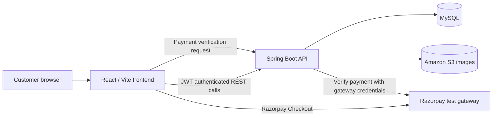

# Cravely 🍽️

**Cravely** is a full-stack food-ordering application inspired by popular food-delivery platforms. It combines a Java/Spring Boot REST API with a React frontend and supports restaurant discovery, menu browsing, customer carts, order placement, and Razorpay test payments.

## 🎬 Application Demo

Experience Cravely — a full-stack food delivery application[cravely-demo.mov](Cravely/cravely-demo.mov)
built with Java, Spring Boot, React, MySQL, and Razorpay.

## 🎬 Application Demo

[▶️ Watch Cravely Demo](assets/cravely-demo.mov)

> **Project status:** Local customer MVP implemented and tested manually. Cloud deployment is planned. This README documents the features discussed and should be checked against the repository before publishing.

## Features

### Customer experience
- Customer registration and JWT-based login
- Browse restaurants and view their menus
- Menu categories, dish descriptions, prices, and images
- Add dishes to a cart; increase or decrease quantities
- Checkout and create orders
- Pay using Razorpay **test mode**
- View personal order history, including items, quantities, totals, and order statuses

### Backend capabilities
- REST APIs for restaurants, menus, carts, orders, authentication, and payments
- Role-based authorization for customers, administrators, restaurant owners, and delivery partners
- Restaurant-owner order transitions (accept, reject, prepare, ready for pickup)
- Delivery partner assignment and delivery completion endpoints
- Customer order cancellation endpoint
- Database schema migrations with Flyway
- S3-backed restaurant/menu imagery integration

> Some role-specific backend endpoints exist, but dedicated admin, restaurant-owner, and delivery-partner frontend workflows have **not** been verified as complete.

## Tech stack

| Layer | Technology |
| --- | --- |
| Frontend | React, TypeScript, Vite, React Router, Axios |
| Backend | Java, Spring Boot, Spring Security, Spring Data JPA |
| Database | MySQL |
| Schema migrations | Flyway |
| Authentication | JWT and role-based authorization |
| Payments | Razorpay (test mode) |
| Images | Amazon S3 integration |
| Build | Maven (backend), npm (frontend) |

## Repository structure

```text
Cravely/
├── Cravely/                   # Spring Boot application
│   ├── src/main/java/com/project/cravely/
│   │   ├── controllers/
│   │   ├── dto/
│   │   ├── models/
│   │   ├── services/
│   │   └── enums/
│   ├── src/main/resources/    # Configuration and Flyway migrations
│   ├── mvnw
│   └── pom.xml
├── frontend/                  # React + TypeScript application
│   ├── src/
│   │   ├── pages/
│   │   ├── context/
│   │   └── api/
│   └── package.json
├── restaurant-images/         # Local image assets (if retained in repository)
└── README.md
```

## Architecture



**Typical customer flow:** Sign in → browse restaurants → select dishes → adjust cart → place order → pay → view My Orders.

## Prerequisites

- JDK compatible with the version specified in `Cravely/pom.xml` (the project was developed using Java 21)
- Maven Wrapper (`./mvnw` is included)
- Node.js and npm compatible with `frontend/package.json`
- MySQL server
- Razorpay **test** credentials for payment testing
- AWS credentials and an S3 bucket if exercising S3 image upload functionality

## Local setup

### 1. Clone the repository

```bash
git clone https://github.com/<YOUR_USERNAME>/Cravely.git
cd Cravely
```

Replace `<YOUR_USERNAME>` with your actual GitHub username.

### 2. Create the MySQL database

```sql
CREATE DATABASE IF NOT EXISTS cravely;
```

Create a database user with appropriate privileges, or use an existing local development account.

### 3. Configure backend environment variables

Create **`Cravely/.env`** locally. Do **not** commit it.

```dotenv
DB_USERNAME=your_mysql_username
DB_PASSWORD=your_mysql_password
# Add the JWT, Razorpay, and AWS variables referenced by your backend configuration.
# Use test credentials only for local payment testing.
```

The backend's known local datasource configuration is:

```properties
spring.datasource.url=jdbc:mysql://localhost:3306/cravely
spring.datasource.username=${DB_USERNAME}
spring.datasource.password=${DB_PASSWORD}
spring.jpa.hibernate.ddl-auto=validate
spring.flyway.enabled=true
```

**Important:** `.env` is not automatically loaded by Spring Boot. Load it into your shell before starting the app, or use your IDE's environment-variable configuration. Check `application.properties` / `application.yml` for the exact names of all required secrets.

### 4. Start the backend

```bash
cd Cravely
set -a
source .env
set +a
./mvnw spring-boot:run
```

The local backend has been run at **`http://localhost:8080`**. Flyway migrations should run at startup when configured.

### 5. Start the frontend

Open another terminal at the repository root:

```bash
cd frontend
npm install
npm run dev
```

Open the URL printed by Vite (commonly `http://localhost:5173` or `http://localhost:5174`). Confirm that the Axios base URL or Vite proxy points to your backend's `/api` endpoints.

## Selected API endpoints

The routes below are based on the existing Spring Boot controllers. The backend uses the `/api` prefix.

### Restaurants and menus

| Method | Endpoint | Purpose |
| --- | --- | --- |
| GET | `/api/restaurants` | List restaurants |
| GET | `/api/restaurants/active` | List active restaurants |
| GET | `/api/restaurants/{id}` | Restaurant details |
| GET | `/api/restaurants/{restaurantId}/menu` | Restaurant menu |
| GET | `/api/restaurants/{restaurantId}/menu/available` | Available dishes |
| GET | `/api/menu-items/{id}` | Menu item details |

### Cart and orders

| Method | Endpoint | Access / purpose |
| --- | --- | --- |
| GET | `/api/cart` | Retrieve current cart |
| POST | `/api/cart/items` | Add an item (uses `menuItemId` and `quantity` parameters) |
| POST | `/api/orders` | Customer: place order |
| GET | `/api/orders/my-orders` | Customer: personal order history |
| GET | `/api/orders/{orderId}` | Customer: own order details |
| GET | `/api/orders` | Admin: all orders |
| PATCH | `/api/orders/{orderId}/cancel` | Customer: cancel own order |
| PATCH | `/api/orders/{orderId}/accept` | Restaurant owner: accept |
| PATCH | `/api/orders/{orderId}/reject` | Restaurant owner: reject |
| PATCH | `/api/orders/{orderId}/preparing` | Restaurant owner: preparing |
| PATCH | `/api/orders/{orderId}/ready` | Restaurant owner: ready for pickup |
| PATCH | `/api/orders/{orderId}/assign-delivery?deliveryPartnerId={id}` | Admin/owner: assign delivery |
| PATCH | `/api/orders/{orderId}/delivered` | Delivery partner: delivered |

### Payments

| Method | Endpoint | Purpose |
| --- | --- | --- |
| POST | `/api/payments/orders/{orderId}` | Create Razorpay payment order |
| POST | `/api/payments/verify` | Verify payment response |

The frontend uses an `Idempotency-Key` when creating a payment order. Refer to `PaymentController.java`, `CartController.java`, and `AuthController.java` for full request/response schemas and additional endpoints.

## Order response example

The `GET /api/orders/my-orders` endpoint returns an array of orders with this shape (illustrative values):

```json
[
  {
    "id": 101,
    "userId": 12,
    "restaurantId": 3,
    "deliveryPartnerId": null,
    "items": [
      { "menuItemId": 9, "name": "Chicken Biryani", "price": 249.00, "quantity": 2 }
    ],
    "totalAmount": 498.00,
    "status": "PLACED",
    "createdAt": "2026-11-21T19:30:00",
    "version": 0
  }
]
```

Actual status values are defined in `OrderStatus.java`; the example is not a recorded order.

## Tests and builds

Run backend tests:

```bash
cd Cravely
./mvnw test
```

Build backend JAR:

```bash
./mvnw clean package
```

Validate and build the frontend:

```bash
cd ../frontend
npx tsc --noEmit
npm run build
```

Before deployment, manually test: login, restaurant browsing, adding/removing cart items, checkout, successful and failed test payments, My Orders, and unauthorized API access.


